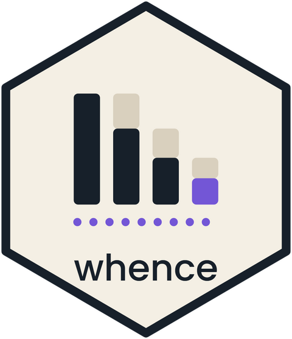

# whence 

<!-- badges: start -->
[](https://CRAN.R-project.org/package=whence)
[](https://CRAN.R-project.org/package=whence)
[](https://github.com/tenmeh/whence/actions/workflows/R-CMD-check.yaml)
<!-- badges: end -->

Click a number in a 'shiny' dashboard and see where its data went.

`whence` answers one question: *"Why is this number smaller than I
expected?"* The answer is an attrition waterfall. It shows how many rows
each step of the pipeline removed, and gives the code that makes the number
again. It works for a single value, for each row of a summary table, and for
each bar or point of a plot of one.

```
$4,281,330

  Where the rows went
    sales                 18,442 rows
      region == "APAC"     3,180 rows   -15,262 rows (83%)
      year >= 2023         1,204 rows    -1,976 rows (62%)
      aggregated to 1 row      1 row

  Reproduce                                        [Copy]
    sales |>
      filter(region == "APAC") |>
      filter(year >= 2023) |>
      summarise(total = sum(revenue))

  [View the rows]
```

## Limits

Read these first.

- **Database-backed pipelines are not supported.** With 'dbplyr', the steps
  become SQL and nothing runs until `collect()`. There are thus no row
  counts to show for each step. `whence` stops with an error for a
  `tbl_lazy`, and does not show a waterfall that would mislead. This
  excludes many large dashboards.
- **Joins are not traced.** A join ends the chain. The join and everything
  upstream of it become the source row of the waterfall.
- **Window functions** (a `mutate()` after `group_by()` that reads other
  rows) are counted correctly. Their row attribution has no clear meaning.
- The verbs of 'data.table', 'arrow' and 'duckplyr' are not known.
- A table or a plot is explained row by row when it is the result of a
  summary step (`summarise()`, `count()` or `tally()`) that keeps its group
  columns. A plot must be a 'ggplot2' plot of that table.

## Installation

Install the released version from CRAN:

```r
install.packages("whence")
```

To get the development version from GitHub:

```r
# install.packages("pak")
pak::pak("tenmeh/whence")
```

## Usage

Replace `textOutput()` and `renderText()` with `whenceOutput()` and
`renderWhence()`. Give the render a pipeline that ends in one value.
You do not need to rewrite it.

```r
library(shiny)
library(dplyr)
library(whence)

ui <- fluidPage(
  selectInput("region", "Region", c("APAC", "EMEA")),
  whenceOutput("total", label = "Revenue")
)

server <- function(input, output, session) {
  output$total <- renderWhence(
    sales |>
      filter(region == input$region) |>
      filter(year >= 2023) |>
      summarise(total = sum(revenue)),
    format = scales::label_dollar()
  )
}
```

`format` turns the value into the text to show. Any function works, and so
does a formatter of 'scales'. It runs on the server, so it can read inputs.

The viewer clicks the value, or presses Enter on it, and a panel opens. The
panel holds the waterfall and the code. It opens with no trip to the server.
"View the rows" asks the server for the rows that make the value, and a
click on a removed count, such as "-1,976 rows (62%)", shows the rows that
the step removed.

## Tables and plots

A summary table explains each of its rows. Click the first cell of a row to
see how many rows of that group each step removed:

```r
ui <- fluidPage(
  whenceTableOutput("by_region", label = "Revenue by region"),
  whencePlotOutput("plot_region", label = "Revenue by region")
)

server <- function(input, output, session) {
  output$by_region <- renderWhenceTable(
    sales |>
      filter(year >= 2023) |>
      group_by(region) |>
      summarise(total = sum(revenue)),
    format = list(total = scales::label_dollar())
  )

  # The same summary, as bars. A click on a bar explains its row.
  output$plot_region <- renderWhencePlot(
    sales |>
      filter(year >= 2023) |>
      group_by(region) |>
      summarise(total = sum(revenue)),
    plot = function(data) ggplot(data, aes(region, total)) + geom_col()
  )
}
```

Under a plot, "Show the data" gives the same table, so a keyboard user can
open each panel too. A computed axis, such as
`aes(reorder(region, total), total)` for sorted bars, works.

`whence_opened()` lets the app follow the viewer. It gives a reactive with
the row whose panel is open:

```r
opened <- whence_opened("by_region")
output$detail <- renderText({
  req(opened())
  paste("Looking at", opened()$data$region)
})
```

The demo has a few outputs to try. It also runs in your browser, with no
install, on the [live demo](https://tenmeh.github.io/whence/articles/live-demo.html)
page. To run it on your machine:

```r
shiny::runApp(system.file("examples", "demo", package = "whence"))
```

## With no 'shiny'

The engine works on its own:

```r
trace <- whence_trace(
  mtcars |>
    filter(cyl == 4) |>
    filter(mpg > 25) |>
    summarise(mean_hp = mean(hp))
)

trace                 # the waterfall, as text
as.data.frame(trace)  # one row for each step
whence_value(trace)   # the value
whence_code(trace)    # the reproduce code
whence_rows(trace)    # the rows of mtcars that make the value
whence_rows(trace, step = 2)  # the rows that step 2 removed; print() shows the numbers

# A summary table, and one of its rows
by_cyl <- whence_table(mtcars |> filter(hp > 90) |> count(cyl))
whence_group(by_cyl, cyl = 6)  # the row of 6 cylinders
```

## How it works

The native pipe leaves no trace in the parsed code: `x |> f() |> g()` is
`g(f(x))`. `whence` thus knows a list of verbs, such as `filter()`,
`mutate()`, `summarise()` and `slice_max()`. For a call to one of these, the
first argument is the data from upstream. The magrittr pipe `%>%` works too.

Each step runs once, in order, in the environment of the render. It reads
the same inputs as the full expression would. This is the same work as
running the pipeline in one piece.

A summary step is not attrition. When `summarise()` turns 1,204 rows into
one, the waterfall says "aggregated to 1 row", and not "-1,203".

A row of a table is explained from a replay of the steps with a hidden id
column (see below), not by a new run of the pipeline for one group. A step after the summary that compares groups,
such as `mutate(share = total / sum(total))`, thus keeps its true value. The
code of a row is the code of the table with a last `filter()` on the group.

The rows that make the value are found only when the viewer asks for them.
The steps then run again on a copy of the source with a hidden id column.
After `distinct()`, `pivot_longer()`, `pivot_wider()` or a step that is not
a known verb, the link to the source rows is lost. The panel then says so,
and the waterfall still works.

In the reproduce code, only `input$name` and `input[["name"]]` are replaced
by their values. Each other name is written as it is, because a wider rule
could replace a name that a verb reads as a column.

## Related packages

- 'lineager' tags rows with lasting ids that survive joins, for audit. It is
  a tool for the analyst. `whence` is a tool for the viewer of a dashboard:
  one click, no change to the pipeline, counts and not identities.
- 'dplyneage' traces the lineage of columns.
